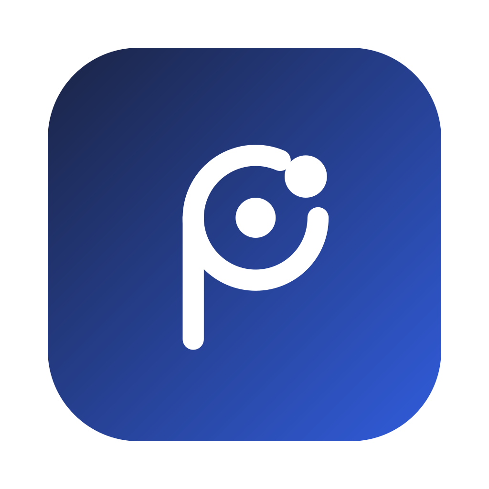

<p align="center"></p>

<h1 align="center">Pilion Browser</h1>

<p align="center"><b>Let your coding agent drive a real browser on your own logins — and approve every click.</b></p>

<p align="center">
Pilion is a desktop browser that hands its tabs to the agent you already use — Claude Code, Codex, Gemini CLI and five more. No headless farm, no fresh logged-out profile: the agent works inside <i>your</i> normal browser, you see exactly what it's about to do, you can take over mid-task, and the conversation resumes after a restart.
</p>

<p align="center">
<a href="https://github.com/echoVic/pilion-browser/releases"><b>Download</b></a>
&nbsp;&nbsp;·&nbsp;&nbsp;
<a href="#%E5%AE%89%E8%A3%85">Install</a>
&nbsp;&nbsp;·&nbsp;&nbsp;
<a href="docs/architecture.md">How it works</a>
&nbsp;&nbsp;·&nbsp;&nbsp;
<a href="CHANGELOG.md">Changelog</a>
</p>


### Why Pilion

- **8 agents out of the box** — Claude Code, Codex, Gemini CLI, Grok Build, OpenCode, Pi, Orca and Blade are auto-detected; ACP adapters install on demand without touching your global CLI.
- **Approval, not blind trust** — switch to *approve-before-action* and every navigation, click and keystroke waits for your **Allow**; one click takes the wheel back. Prefer speed? Run full-access.
- **Record once, replay as a skill** — capture a walkthrough once and let the agent replay it with `browser_skills_play` instead of burning tokens re-discovering the same pages.
- **Remote agent, local browser** — run an agent on a VPS over SSH while it drives the browser on *this* machine, against your logged-in session.
- **Resumable sessions** — chats keep the ACP session id and reconnect via `session/resume`, so a restart never means starting over.
- Ships for macOS, Windows and Linux, updates itself, and is MIT licensed.

Under the hood Pilion is a desktop browser for [Agent Client Protocol](https://agentclientprotocol.com) agents. It exposes its tabs to the agent over MCP — `browser_snapshot` / `browser_screenshot`, navigate, click, type, plus `browser_skills_list` / `browser_skills_play` — with approval-before-action, human takeover and session resume.

---

面向人机协作的桌面浏览器：把你正在用的编码 Agent（Claude Code、Codex、Gemini CLI 等 8 个）接进一个**带着你登录态的真实浏览器**，右侧下达任务，中间实时观看；可一键切到「操作前确认」逐步放行，也可随时接管，重启后会话自动续上。支持 SSH 远端 Agent 驱动本机浏览器，以及录制一次、回放为技能。

每版变化见 [更新日志](CHANGELOG.md)。

## 安装

从 [Releases](https://github.com/echoVic/pilion-browser/releases) 下载对应平台的安装包：macOS 为 dmg，Apple Silicon 选 arm64，Intel 选 x64；Windows 为 exe 安装程序；Linux 为 AppImage 或 deb。Windows 安装包未签名，遇到 SmartScreen 提示时选「更多信息 → 仍要运行」。

装好之后 Pilion 会自己检查和下载新版本，提示重启或在退出时安装，可以在「设置 › 通用 › 更新」里关掉。Linux deb 包只提示新版本，需要自己下载安装。

## 运行

需要 Node.js 22.13+ 和 pnpm 10。桌面应用基于 Electron 43。

```bash
pnpm install
pnpm build
pnpm start
```

开发模式为 `pnpm dev`。Vite 地址仅用于界面预览；真实网页、Agent、审批与持久化需要 Electron。

## 空间与标签

侧栏顶部切换或创建空间，例如“工作”“阅读”。标签菜单可将页面固定在当前空间，或设为所有空间都能看到的常用标签；也可移动到另一个空间。空间共享登录态，切换不会中断 Agent 的后台任务。

普通标签闲置 24 小时后自动归档，当前页、播放音频、录制和 Agent 工作页会保留。可在「设置 › 浏览器」调整时长或关闭归档，在侧栏「已归档标签」恢复页面。

按 `⌘/Ctrl+T` 搜索标签、书签、历史或命令；方向键选择，回车打开，Esc 关闭。输入 `>` 只查命令。`⌘/Ctrl+Shift+C` 复制当前网址。详见 [设计与验收](docs/design/arc-features.md)。

## 本地 Agent

在「Agent 连接 → 本地 Agent」中直接选择 Claude Code、Codex、Gemini CLI、Grok Build、OpenCode、Pi、Orca 或 Blade。应用自动检测已有 CLI 和 ACP 适配器；可手动指定 Node.js 路径，也可用文件夹按钮选择工作目录。默认使用 userData 下的独立 `workspace-files` 目录。

已安装的 ACP 适配器优先复用，包括旧版 `claude-code-acp`。缺少适配器时显示「安装并连接」，先用 npm 把固定版本装进 Pilion 数据目录下的 `adapters/`，装好再连接。首次安装可能需要几分钟，设置页和 Agent 面板会显示已下载的大小和用时；新版本装好后，同一适配器的旧版本会被删掉。Claude 使用 `@agentclientprotocol/claude-agent-acp@0.89.1`，Codex 使用 `@agentclientprotocol/codex-acp@1.10.0`。Gemini 直接使用 CLI 的 ACP 模式，缺少 CLI 时使用 `@google/gemini-cli@0.58.0`。不会修改全局 CLI 安装。

浏览器 MCP 同时提供 `browser_snapshot` 和 `browser_screenshot`：前者返回 URL、标题、loading、可见文字和元素语义，后者返回当前标签页 PNG。Agent 可以结合结构化页面状态与视觉页面状态决定下一步操作。`browser_skills_list` 与 `browser_skills_play` 让 Agent 发现并回放你录制并提炼过的技能，省去一步步摸索；同一任务内首次回放需要你确认一次。

| Agent      | ACP 启动方式                   | 首次安装                                    |
| ---------- | ------------------------------ | ------------------------------------------- |
| Grok Build | `grok agent --no-leader stdio` | 复用官方 Grok Build CLI，缺少时提示安装     |
| OpenCode   | `opencode acp`                 | `opencode-ai@1.18.29`                       |
| Pi         | `pi-acp`                       | `@automatalabs/pi-acp@0.6.3`                |
| Orca       | `orca --mode=acp`              | `@blade-ai/orca@0.4.31`，或官方原生安装脚本 |
| Blade      | `blade --acp`                  | `blade-code@0.10.205`                       |

[Orca](https://github.com/echoVic/orca-agent) 是 DeepSeek 原生的编码 Agent，[Blade](https://github.com/echoVic/blade-code) 支持 38+ 模型 Provider，两者由 Pilion 作者维护，原生实现 ACP，并会接入 Pilion 下发的浏览器 MCP 工具。

Grok Build 与 OpenCode 的原生可执行文件不依赖 Node.js。Pi 使用内嵌 Pi SDK 且支持宿主 MCP 转发的适配器，要求 Node.js 22.19+，不要求额外全局安装 Pi。名称同为 `pi-acp` 的其它实现不会被自动复用，以免连接后缺少浏览器工具；可通过自定义连接使用自己选定的实现。Pi 沿用 `~/.pi/agent` 的认证和配置，OpenCode、Grok 沿用各自的本机登录。Orca 使用 `DEEPSEEK_API_KEY`，Blade 沿用 `~/.blade/auth.json` 中的凭证；Blade 同样要求 Node.js 22.19+。

检测覆盖 PATH、nvm、Homebrew、Volta、`~/.grok/bin`、`~/.opencode/bin` 等常见目录；选定 Node.js 的目录会进入 Agent 的 PATH。默认使用 Agent 自己的本机登录配置。

其它 ACP 实现和远端连接放在「自定义 / 远端」中。自定义启动参数为 JSON 数组，例如 `["--acp"]`；高级设置可配置环境变量和认证方式 ID。

自定义启动命令必须实现 ACP stdio，普通聊天 CLI 或 HTTP 模型地址不能直接作为 ACP Agent。Agent 需要的登录、订阅或 API 认证由对应 Agent 管理；连接状态来自主进程真实握手结果。

## 远端 Agent

选择「远端 SSH」，填写 SSH 主机（支持 `user@host` 或已有 SSH 别名）、端口、远端 ACP 命令、参数和绝对工作目录。可使用现有 SSH 配置或指定本地私钥路径。

前置条件：

- 本机可以通过 `ssh user@host` 使用密钥登录，主机指纹已确认。
- 远端为 Unix，已安装 ACP Agent 和支持 `nc -U` 的 netcat（Ubuntu/Debian 通常为 `netcat-openbsd`）。
- SSH 服务允许 Unix socket 反向转发。

ACP 消息通过 SSH stdio 传输。浏览器 MCP 使用独立的 SSH 私有 socket 回程，所以远端 Agent 可以操作本机浏览器。远端无需安装 Pilion，也不会使用本机 Electron 可执行文件路径。

## 工作流

- 地址栏支持 URL 和网络搜索；标签页支持复制、恢复关闭和按序号切换，关闭当前标签时自动选择相邻标签。
- 浏览工具栏提供页内查找、分级缩放和重置缩放；加载期间刷新按钮切换为停止按钮。
- 地址栏和「Agent 连接」设置页都可以一键从本机 Chrome 导入 cookie，当前仅 macOS；导入前会说明范围并要求确认，密钥来自系统钥匙串。
- 下载默认保存到系统下载目录，可以在「设置 › 浏览器」里换一个文件夹；下载页显示进度并支持暂停、继续、取消、打开和在文件夹中显示；下载记录随工作区恢复。
- 「设置 › 浏览器」可以清除浏览记录、下载记录、Cookie 和网站数据、缓存，清除前先确认，只清网页的数据。
- macOS 上可以在「设置 › 通用」把 Pilion 设为默认浏览器。之后其他应用里点开的链接会在 Pilion 的新标签页打开，照常经过网址规则，不会交给 Agent。
- 右侧对话面板按 7 层结构组织：会话标签行（多会话切换 + 待审批角标）→ 状态条（Agent 名、权限模式、模型）→ 消息流（流式回复、思考过程、工具行独立渲染，上翻不强制拉回）→ 审批坞（固定于滚动区外，琥珀色高亮）→ 任务控制条（running 态显示「接管」，manual 态显示「继续任务」「停止」）→ 输入区（权限模式切换、附件、技能选择器）。强调色为 Teal（`--chat-*` token），支持深色/浅色/跟随系统。
- 打开历史对话时自动切回原 Agent：连接中显示横幅提示，历史消息可照常浏览；原 Agent 已删除或禁用时提示「不可用」并提供选用其他 Agent 入口（不带之前上下文）；恢复失败或并发上限时提供重试。前端只渲染主进程快照，不自行推断 Agent。
- 输入框内可选择「完全访问」或「操作前确认」，默认完全访问，自动批准浏览器和 ACP 工具权限请求；若 Agent 提供完整访问模式，会同步切换该模式。权限模式按对话保存：切换只影响当前对话，正在运行中的会话不能改自己的模式。
- 输入框内可选择 Agent 实际返回的模型，兼容 ACP config options 和旧版模型列表；未配置模型或未提供选择能力时显示 Agent 默认模型。
- 支持 Agent 协商出的 session-scoped goal：长期任务、异步更新、接管和停止均由 Agent 能力驱动；未声明 goal 的 Agent 保持标准单回合 ACP 行为。
- Agent 运行中可以继续打字：回车把消息排进输入框上方的队列，回合结束自动合并成一条发出，可撤回回输入框或删除；`⌘/Ctrl+Enter` 先打断当前回合再立即发送（含队列）。
- 输入框支持粘贴、拖放或选择图片（最多 5 张、单张 5MB、png/jpeg/webp/gif），以 ACP 图片块发给 Agent；是否可用取决于 Agent 公布的图片能力，不支持时明确禁用并提示，不会静默丢弃。
- 输入框打 `/` 从已提炼的录制技能里挑选并插入提示，让 Agent 用 `browser_skills_play` 运行该技能。
- Agent 在普通对话里写出的技能块会成为「修改提案」，由你选定一份已提炼技能并确认后才写入，写入仍过与手工编辑相同的分权校验（不能新增录制里没有的动作）。
- 「操作前确认」下，审批显示在 Agent 面板输入框上方，按钮始终可见，长详情可展开查看。不会打开独立弹窗；页面变化、取消或断开连接会使审批失效。
- 新对话创建新 ACP session。历史对话保存 Agent session ID，重新连接时按能力使用 `session/resume` 或 `session/load`，不把历史消息拼接进用户 prompt。
- 深浅色与系统主题可切换；左右栏可收起。网页获得焦点时仍支持地址栏、标签、查找、刷新、缩放和前进后退等常用 `Cmd/Ctrl` 快捷键，全部快捷键见「设置 › 快捷键」。
- 「设置 › 定时任务」可以按间隔、每天定点、指定星期或五段 cron，在后台自动给绑定的 Agent 发一条 Prompt；到点另开一条后台对话运行，跑完发系统通知，睡眠错过的任务启动或唤醒后补跑一次。每条任务可单独选运行权限（默认「操作前确认」，无人审批时 60 秒自动拒绝）。

## 外部 CLI / MCP

Pilion 可以把同一个治理过的浏览器开放给本机的命令行工具或 MCP Agent（Claude Desktop、Cursor 等）使用。**默认关闭**；在「设置 › 通用 › 对外控制」打开开关前先看下面的风险。

开启后 Pilion 会在 userData 下建一个 `external/` 目录（权限 `0700`），里面：

- `external.sock`：Unix socket（`0600`），只允许当前用户连；
- `clients.json`：客户端注册表（`0600`），**只存每个客户端 token 的 scrypt 哈希 + 独立 salt，绝不落明文**。

**按客户端签发凭证。** 在设置页「外部控制」点「新增客户端」（内联输入框填一个名字，如 `claude-desktop`，点确定），Pilion 生成一个随机 token，形如 `pct_<clientId>_<secret>`（`pct_` 前缀 + 8 字节 clientId + 32 字节 secret），**只在创建时展示/复制一次**，之后磁盘和 IPC 都拿不到明文。每个客户端有独立的 `clientId`、名称、创建时间、最后使用时间、是否吊销。

连接必须先过 token 认证；**身份由 token 决定**——hello 帧只带 token（带不带 `client` 字段都被忽略），服务端反查注册表得到 `principal = external:<clientId>`，之后每次连接在 Host 里固化成独立 session + attachment + lease。不同客户端的 principal 不同，**Tab ACL 互相隔离**，不再有「同名即同身份」。外部调用和内置 Agent 走同一条 Intent / 审批 / 执行凭证 / fencing / 审计链路；外部 principal 默认对任何标签没有权限，只能操作它自己 `tabs.open` 打开的标签（你同时是 owner）或你在 UI 里显式授予的标签。「操作前确认」模式下，外部的效果操作会在 Pilion 界面弹审批，摘要标注「来源：外部调用（external:<clientId>）」。

**吊销 / 删除**：设置页可单独吊销或删除某个客户端。吊销会立即断开它的活动连接、摘掉它自己的 Tab ACL、写审计，之后该 token 再连直接被拒；删除连记录一起移除。「关闭开关」的行为不变（socket 停止监听）。

**接外部 Agent**：新增客户端后会弹出它的 MCP 配置 JSON（含该客户端自己的 token），点「复制 MCP 配置 JSON」粘进 Claude Desktop / Cursor 的 `mcpServers` 即可。这份配置**只在设置窗口内按需取到**，不随主窗口状态广播。

**用命令行**：把上面配置里的 `command`（Electron 可执行文件）配合 `external/pilion-cli.js` 脚本，并通过环境变量注入 socket 与该客户端的 token：

```bash
export PILION_EXTERNAL_SOCKET="<userData>/external/external.sock"
export PILION_EXTERNAL_TOKEN="<新增客户端时拿到的 token>"
"<command>" "<应用资源>/dist/main/main/external/pilion-cli.js" tabs
"<command>" "<应用资源>/dist/main/main/external/pilion-cli.js" new https://example.com
"<command>" "<应用资源>/dist/main/main/external/pilion-cli.js" read
"<command>" "<应用资源>/dist/main/main/external/pilion-cli.js" observe   # 拿 elementRef
"<command>" "<应用资源>/dist/main/main/external/pilion-cli.js" click --ref '<elementRef json>'
"<command>" "<应用资源>/dist/main/main/external/pilion-cli.js" screenshot -o shot.png
```

加 `--json` 输出机器可读结果。CLI **不再自动读取 userData 里的共享 token**——它只认 `PILION_EXTERNAL_SOCKET` + `PILION_EXTERNAL_TOKEN`（或用 `PILION_EXTERNAL_TOKEN_FILE` 指向你自己保存的 0600 文件）；缺了会提示先在设置页新增客户端。

`screenshot -o file.png` 只写 `.png`：默认拒绝已存在的文件（`--force` 才覆盖），且任何情况下都拒绝写入符号链接路径，防止被引向任意位置。

**开放的工具（白名单 `EXTERNAL_TOOLS`，共 15 个）**：

- 标签：`browser.tabs.list` / `tabs.open` / `tabs.activate` / `tabs.close`
- 观察：`browser.observe` / `snapshot` / `page_info` / `screenshot`
- 交互：`browser.navigate` / `click` / `type` / `select` / `check` / `press`
- 技能只读：`browser.skills.list`

**刻意不开放的工具（2 个，共 17 个内置工具）**：

- `browser.request_human`：会把浏览器交还人、打断正在进行的任务。外部 Agent 是独立进程，没有 Pilion 的任务上下文，贸然交还浏览器会和人正在做的事抢同一个标签。
- `browser.skills.play`：录制技能回放耦合在 Agent 的任务 / 审批链路上（同任务内首次回放要一次审批、逐步记账），外部 principal 不挂在任何会话里，强行复用会破坏这套记账与续播语义。
- 此外**不提供任意 JavaScript 执行**；审批、执行凭证、fencing、页面引用校验、私网拦截全部保留。

**迁移**：旧版（0.1.10 之前）用过一个单共享 token 的 `external-mcp.json`。升级后它不再是凭证，启动时会被自动删除并写一条 `external.legacy_config.removed` 审计；**旧配置里的 token 作废，请在设置页重新「新增客户端」拿新 token 并替换 Claude Desktop / Cursor 配置与 CLI 环境变量。**

**风险**：每个客户端的 token 本身就是凭证——任何拿到它的本地进程都能以该客户端身份在你本机驱动这个浏览器。它仍受审批和审计约束，但请只在信任的环境里开启；泄露某个客户端就到设置页吊销它（立即断开、摘 ACL），不用时关掉总开关，socket 立即停止监听。未认证的连接/在途 hello 槽位有上限（8），但同一用户下的恶意进程仍可能把这些槽位占满约 15 秒（hello 超时窗口），期间新的外部连接会被拒；这是按设计的拒绝面，不是漏洞，但意味着外部通道在被本机进程持续刷连接时会暂时不可用。

**Windows**：该功能基于 Unix domain socket。Windows 上的 chmod 权限位无效，命名管道（named pipe）的访问控制列表（ACL）需要额外实现与本机验证，因此 Windows 上设置页会禁用该开关并给出说明。

**认证与拒绝**：token 带 `pct_<clientId>_` 前缀，服务端从前缀直接定位到唯一客户端、只做一次（异步）scrypt 比对，不必遍历全部客户端，避免未认证方用同步哈希阻塞主进程。认证失败后连接立即 destroy、同连接不能反复重发 hello；未认证的在途连接数与同时在线连接数都有上限。一个 chunk 里的多条 hello 只认第一条，每个连接最多接纳一次。注册表的创建/吊销/删除/记最后使用时间走串行队列，并发交错不会把吊销写丢。

## 存储与边界

Electron userData 下的 `agents.json` 保存连接配置，`workspace.json` 保存对话/书签/历史/标签，`host.sqlite` 保存执行审计。JSON 文件权限为 `0600`，但并非加密存储；环境变量中的敏感值应优先由 Agent 自己的凭证系统管理。

当前支持一个个人工作区，以及多个对话各自连一个 ACP Agent 同时在后台运行（同一时刻最多 4 个会话）。Agent 新开的标签默认留在后台，需要渲染或输入时临时唤醒、静置 30 秒后回落，不会抢走你正在看的标签。网页使用独立沙箱，默认拒绝私网和 loopback 地址。下载文件不会自动打开，Renderer 只能按下载记录 ID 请求主进程操作下载目录（系统下载目录或设置里选定的文件夹）内的文件。SSH 使用标准 ACP，不实现仍处草案阶段的 ACP HTTP transport。尚未包含扩展、密码管理和跨设备同步；Windows 和 Linux 安装包未签名。

详细设计见 [架构说明](docs/architecture.md)。

## 打包

```bash
pnpm dist   # 当前平台安装包，输出到 release/
pnpm run pack   # 只生成未压缩的应用目录，便于本地冒烟
```

打包由 electron-builder 完成，配置见 `electron-builder.yml`。推送 `v*` 标签会触发 GitHub Actions 在 macOS、Windows、Linux 上构建并上传到草稿 Release。仓库 secrets 配置了 `CSC_LINK`、`CSC_KEY_PASSWORD`、`APPLE_ID`、`APPLE_APP_SPECIFIC_PASSWORD`、`APPLE_TEAM_ID` 后，macOS 包会自动签名并公证；未配置时产出未签名包。

在 GitHub 上把草稿 Release 点「发布」之后，已安装的 Pilion 会读到 Release 里的 `latest-mac.yml`、`latest.yml`、`latest-linux.yml` 并开始更新；草稿和预发布不会推送给用户。

## 验证

```bash
pnpm typecheck
pnpm lint
pnpm test
pnpm test:e2e
```

设置 `PILION_E2E_EXECUTABLE` 指向打包后的可执行文件，可让同一套 E2E 直接验证安装包。

若 Electron 启动失败并报 `bad option: --remote-debugging-port=0`，或 Playwright 的 loader 报 `Cannot read properties of undefined (reading 'commandLine')`，先看环境里有没有 `ELECTRON_RUN_AS_NODE=1`（Electron 系终端会带着它，Electron 二进制于是当普通 Node 跑）：`env -u ELECTRON_RUN_AS_NODE pnpm test:e2e` 即可。这两条报错来自调用它的 shell，与 Electron、Playwright 的版本无关。

E2E 使用真实 Electron 和隔离 profile，通过确定性 ACP Agent 验证浏览、正文读取、流式消息、人工接管、审批、取消和重启恢复。SSH 测试验证启动转义与真实 MCP socket 通信；实际远端认证需要配置自己的 SSH 主机。

E2E 运行时**不抢系统焦点**：Playwright 启动主进程时注入 `PILION_E2E_NO_FOCUS=1`，主进程的所有「把窗口带到前台」的动作都收口在 `src/main/window-focus.ts`——测试模式下窗口用 `showInactive()` 显示、不调 `app.focus({steal})` / `window.focus()` / `webContents.focus()`，并追加 `--disable-renderer-backgrounding` 等开关保证后台照常渲染。因此你可以一边跑全量 E2E 一边正常用电脑；「外部链接聚焦」这类用例改为经 `__pilionFocus` 钩子断言产品**请求了**激活（而非真的拿到 OS 焦点）。可结合 `scripts/e2e-focus-guard.sh` 采样前台应用，验证 E2E 期间 Pilion/Electron 没有抢到前台。

E2E 使用**临时目录下的隔离 profile**（每次 `mkdtemp` 在 `os.tmpdir()` 下），绝不读写你日常的 `~/Library/Application Support/pilion-browser`。主进程在 `NODE_ENV=test` 或 `PILION_E2E_NO_FOCUS=1` 下会自检：若 `userData` 不在 `os.tmpdir()` 下就直接报错退出（`src/main/e2e-profile-guard.ts`），防止有人从某个 worktree 直接 `electron .`/`pnpm start` 把 agents.json、host.sqlite 写进真实 profile。
