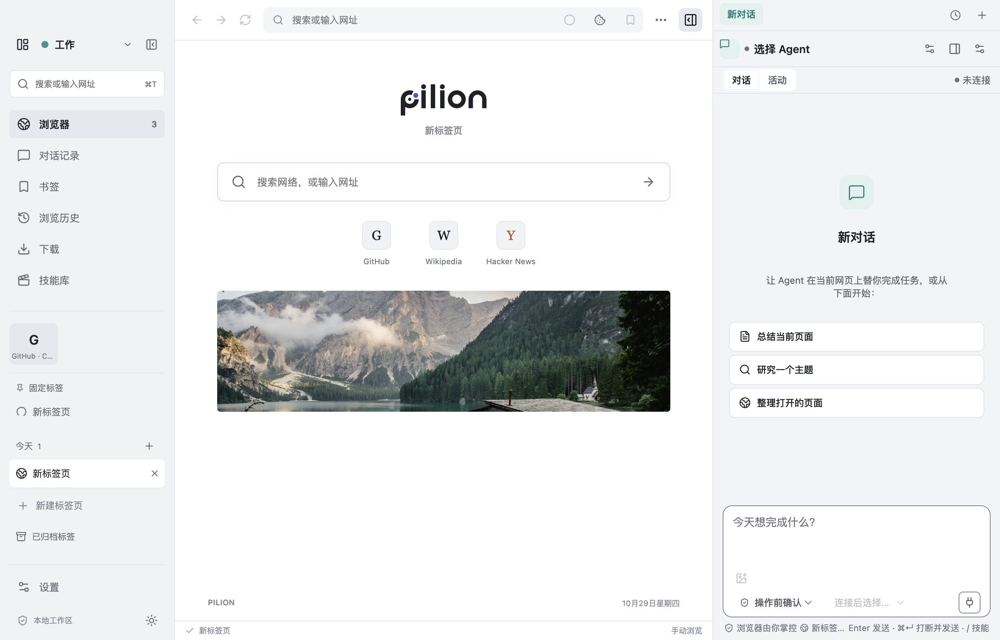
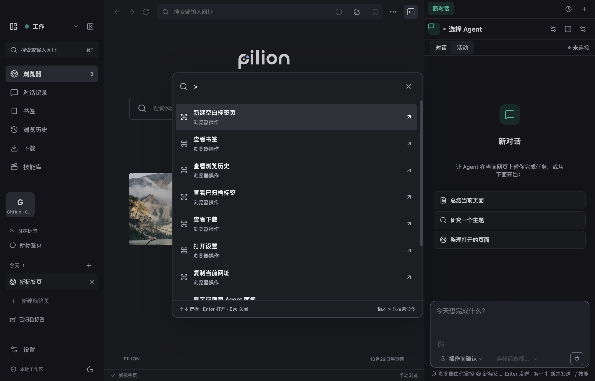

# Arc 的日常浏览体验进入 Pilion

用户希望把 Arc 做得好的功能带到 Pilion。本轮落地 Arc 的标签组织和键盘操作体验，延续 Pilion 现有侧栏、主题和 Agent 协作方式。

## 本轮范围

| 功能               | 用户行为                                                                         | 实现边界                                                                                   |
| ------------------ | -------------------------------------------------------------------------------- | ------------------------------------------------------------------------------------------ |
| Spaces             | 创建、改名、选择颜色、切换空间；把标签移到另一空间                               | 空间是标签组织，所有空间共享现有登录态；切换空间不改变 Agent 会话或权限                    |
| 固定标签与常用标签 | 标签菜单里固定；常用标签显示在所有空间上方；取消固定后回到普通标签               | 固定和常用标签保留页面及原始位置；本轮关闭行为沿用浏览器关闭，恢复关闭仍可用               |
| 自动归档           | 普通标签默认闲置 24 小时归档；设置可关闭或改为 12 小时、3 天、7 天；归档页可恢复 | 当前标签、加载中、播放音频、录制、回放和 Agent 工作标签不自动归档；最多保留 200 条归档记录 |
| 命令栏             | ⌘/Ctrl+T 搜索打开的标签、书签、历史、命令；方向键选择，回车执行，Esc 关闭        | 新建空白页的侧栏按钮仍可直接使用；命令栏显示时隐藏原生网页，关闭恢复                       |
| 复制当前网址       | ⌘/Ctrl+Shift+C，显示复制成功提示                                                 | 主进程仅复制当前标签网址；不增加任意剪贴板读取或写入通道                                   |

Spaces、固定标签、常用标签和自动归档是 Arc 官方 Organize 文档覆盖的核心能力；命令栏则在官方多任务说明中作为统一入口。没有可靠的功能使用率数据，本轮按日常价值、现有代码适配成本和可验证性取舍，不声称这是按用户量统计出的排名。

参考：

- https://resources.arc.net/hc/en-us/sections/19211839689111-Organize
- https://start.arc.net/master-multitasking
- https://start.arc.net/command-bar-actions

## 数据与边界

新增 `workspace.json.tabState` 保存空间、标签元数据和归档记录；旧 `tabs` URL 列表继续镜像保存，以兼容现有恢复验证。旧文件第一次打开时迁入“我的工作区”，闲置计时从迁移时开始。标签恢复后重新生成运行时 ID，不恢复页面授权或旧执行凭证。

主进程管理空间和标签元数据，通过固定 IPC 下发状态。侧栏只绘制当前空间普通/固定标签以及全局常用标签。跨空间激活标签自动切换其空间。Agent 创建标签时优先跟随它原来的工作标签所在空间；用户切空间不会改写 Agent 的目标。空间不构成登录态或权限隔离，Tab ACL 仍为唯一授权依据。

标签组织逻辑独立于 `main.ts`；原生视图装配仍沿用已有代码。菜单、设置和命令栏复用同一份快捷键定义。新增 UI 使用现有 CSS 变量，保持 CSP、地址栏和原生网页边界约束。

## 验收

1. 空间、固定/常用分类、归档记录经保存与重启保留；旧 URL 文件正常迁移。
2. 切换空间只显示该空间的标签，全局常用标签在两边可用，关闭当前页选择同空间相邻标签。
3. 超龄普通标签归档后关闭原生页面；所有受保护标签不受影响；恢复时新建页面。
4. 命令栏可键盘查找标签和执行命令，支持中文输入法，关闭时恢复网页及焦点。
5. Agent 在后台工作时切换空间，目标、审批和运行状态仍属于原会话。
6. 类型检查、lint、单测、针对本轮行为的真实 Electron E2E；全量 E2E 与未经修改的集成基线对照。

## 验证记录（2026-10-29）

- `pnpm build`：通过，包含 renderer 与主进程类型检查。
- `pnpm lint`：通过。
- `pnpm exec vitest run --maxWorkers=4`：78 文件、951 用例全部通过。
- `pnpm exec playwright test --retries=0`：80 通过、1 项原有跳过，没有重试；包含 5 项 Arc 行为用例。
- Impeccable 检查新增侧栏、空间切换器、命令栏与 CSS：0 项发现。
- 真实窗口截图：浅色、深色、840px 窄窗口检查完成，没有 renderer 脚本错误。
- 打包应用冒烟：通过空间/分类恢复、主题切换、命令栏焦点与窄窗口截图，确认 `isPackaged=true`、名称为 `Pilion Arc Preview`。
- 审查发现的在途调用/审批归档、归档恢复 ID、延迟开页空间归属、标签关闭后选择及焦点恢复问题已修正，并通过回归测试。





## 本地预览

本轮提供 Apple Silicon 的 `Pilion Arc Preview.app`。应用名称、bundle ID 与数据目录独立于正式 Pilion；预览配置关闭自动更新。源码与使用说明保存在 `feat/arc-essentials`，正式版本号保持不变。

复现预览打包：

```bash
CSC_IDENTITY_AUTO_DISCOVERY=false pnpm exec electron-builder --dir --mac --arm64 --publish never \
  --config.productName='Pilion Arc Preview' \
  --config.appId=com.echovic.pilion.arc-preview \
  --config.extraMetadata.name=pilion-arc-preview \
  --config.extraMetadata.productName='Pilion Arc Preview' \
  --config.mac.notarize=false \
  --config.directories.output=release/arc-preview
```

## 后续

Split View、Peek、文件夹、独立登录 Profile 和 Arc 导入另做迭代。Split View/Peek 涉及原生页面、蒙层和焦点同时管理；Profile 涉及登录态与授权边界。已有本机 Arc 数据结构探索只用于评估，没有导入任何个人数据或读取钥匙串。

本轮分支已同步至 `feat/panel-redesign@f54096d`。该集成线尚未进入 main；ADR 0001 的真实模型冒烟与外部通道安全复审仍未完成，本轮 Arc 功能验收不替代这两道发布闸口。
